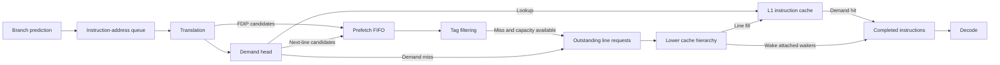

Flexus models processor and memory-system timing as part of QFlex. QEMU supplies
functional instruction information, while Flexus models when instructions and
memory requests can advance. This branch, `feature/next_line_prefetcher`, studies
instruction prefetching into the L1 instruction cache (L1-I).

Relative to the branch starting point, `13234a5`, it adds a physical next-line
prefetcher and a no-prefetch baseline, reworks fetch-directed instruction
prefetching (FDIP) to use the same demand-fetch behavior, and introduces a shared
prefetch queue and cache-line classification. Address generation and branch
prediction retain their original functionality. The purpose is to compare
prefetch candidate selection behind a common demand front end.

The front end separates prediction, translation, demand fetching, and prefetch
issuance. Branch prediction produces an ordered stream of instruction addresses
ahead of instruction delivery. These addresses occupy a fetch address queue
(FAQ): one entry represents one instruction address, so several consecutive
entries can refer to the same physical cache line. Translation can run ahead of
the demand head, and outstanding translations are coalesced at 4 KiB granularity.
The current translation stage permits four new translation requests and sixteen
untranslated-entry checks per cycle.

Demand service is ordered at the FAQ head. A cache hit prepares instructions for
delivery no earlier than the following cycle. A miss joins an outstanding
request for the same physical line, allocates a new request, or waits for request
capacity. One head access can also prepare consecutive translated instructions
on that line, subject to an entry-check budget. While a miss is outstanding,
both policies revisit the head
and attach additional same-line instructions within that budget. Existing
waiters are skipped without charging them again. When the line arrives, all
attached waiters become ready. Delivery remains limited by decode-queue space
and the configured instruction width; delivery itself consumes no additional
cache access.

Three modes share this demand pipeline:

| Mode | `-ufetch:next_line_path` | `-ufetch:next_line_prefetching` | Prefetch candidate source |
| --- | --- | --- | --- |
| FDIP | `0` | Ignored | Younger translated instruction addresses on the predicted control-flow path. |
| No prefetching | `1` | `0` | None; address generation and translation still run ahead. |
| Next-line | `1` | `1` | The next N physical cache-line positions after a demand access. |

FDIP uses the remaining FAQ entry-check budget after demand processing to discover
younger candidates. Entries already covered by demand, queued for prefetching,
or associated with an outstanding request are marked as seen and skipped on
later scans. Discovering a candidate does not read the instruction cache or make
that instruction ready for decode. A full prefetch queue leaves an unseen
candidate eligible for a later scan.

Next-line prefetching generates the next N physical cache-line positions, where
N is configurable. It stops before crossing the current 4 KiB physical region,
even within a larger mapped page. N counts positions rather than successful
requests: skipping a duplicate does not extend the lookahead farther. A full
queue discards the remaining candidates from that trigger without blocking
demand. Three triggers are available. **OnAccess** generates candidates after a
new demand hit or miss, including joining an outstanding request. **OnMiss**
generates them after joining an outstanding request or successfully admitting a
new demand miss. A detected miss blocked by full outstanding-request capacity
does not trigger OnMiss until admission succeeds. Waiting for an already-issued
miss and instruction delivery do not generate additional triggers. A
capacity-blocked retry performs a new lookup and can trigger OnAccess again.
**OnMissOrFirstPrefetchHit** uses the same miss events as OnMiss and also
generates candidates on the first demand hit to an unused prefetch-origin
resident line. Subsequent hits do not trigger. A prefetch first accessed while
still outstanding triggers as a miss; its eventual fill retains that use and
does not trigger again on a later hit. Eviction and a new prefetch fill begin a
new line lifetime.

Both policies feed the same bounded FIFO of unissued physical-line candidates.
An accompanying membership set prevents duplicate queued lines; outstanding
requests are also filtered out. This suppression applies to current queued or
outstanding work, so the same physical line may become a candidate again later.
Demand can overtake a queued candidate: if its prefetch has not issued, demand
can allocate the request, and the queued copy is discarded when processed.

Prefetch issuance is separate from candidate generation and continues on cycles
with no new demand access. The FIFO first checks whether its head already has an
outstanding request. Otherwise, it probes the L1-I tags. These probes retrieve no
instruction data and do not update LRU replacement state. A resident candidate
is removed; a missing candidate requires a free outstanding-request slot before
it can issue. It does not retrieve L1-I data or need another demand lookup slot.
An unissuable miss stays at the head and blocks younger candidates, including
younger hits.

The resource limits describe different pieces of hardware:

| Configuration setting | Architectural meaning |
| --- | --- |
| `-ufetch:faq` | Predicted instruction-address queue capacity, measured in instruction entries. |
| `-ufetch:finst` | Maximum instructions delivered toward decode per cycle, also constrained by downstream queue space. |
| `-ufetch:flines` | Per-cycle demand cache-lookup budget. Unused slots augment prefetch tag probes; a demand joining an outstanding request consumes no cache-data slot. |
| `-ufetch:icache_entry_checks` | Entry checks shared by head processing, same-line waiter attachment, and FDIP discovery. The waiting head costs one check; each newly attached follower costs another. |
| `-ufetch:tag_lookups` | Dedicated prefetch tag probes per cycle. Unused `flines` slots augment this probe budget. |
| `-ufetch:prefetch_queue_size` | Number of unissued physical-line candidates that the shared FIFO can hold. |
| `-ufetch:miss_queue_size` | Maximum distinct outstanding instruction-line requests, shared by demand and prefetching. |
| `-ufetch:next_line_count` | Number of successive physical line positions considered by each next-line trigger. |
| `-ufetch:prefetch_trigger` | Next-line trigger selection: `0` for OnAccess, `1` for OnMiss, or `2` for OnMissOrFirstPrefetchHit. |

Each prefetch tag probe, hit or miss, consumes one credit from the combined
budget of dedicated `tag_lookups` plus unused `flines` slots. A missing line can
issue immediately if an outstanding-request slot is available; it does not
consume another `flines` slot. Recognizing an already-outstanding line requires
neither a tag probe nor another request. With `flines = 1` and `tag_lookups = 1`,
a new demand cache lookup can therefore coexist with one prefetch miss issuance.

The outstanding-line pool (FAM) is the front end's MSHR-like limit. It includes
allocated requests still buffered for transmission as well as requests already
in the hierarchy. Admission into this
pool is distinct from downstream acceptance: outgoing requests can remain
buffered until the memory-system interface accepts them. Prefetches allocate
directly into the modeled L1-I on return and compete with demand lines for cache
capacity and replacement.

On a branch redirect or other squash, the FAQ and unissued prefetch candidates
are discarded. Allocated demand and prefetch requests remain outstanding and
continue consuming capacity until their replies arrive. Their fills may still
populate L1-I, and redirected demand can merge with them. Resident cache lines
and their provenance also survive a squash.

Configure the policy before simulation initialization; switching policies during
a run does not migrate their state. Set `-ufetch:perfect` to `0` to study actual
cache misses and prefetching. Perfect-cache mode bypasses these activities. The
older `-ufetch:prefetch` setting does not control either policy in this branch;
use the mode settings above. Target wiring can override component defaults, so
experiments should set queue sizes and bandwidths explicitly.

Statistics distinguish demand-visible missing lines from prefetch activity.
`<component>-L1Misses`, for example `000-ufetch-L1Misses`, counts a physical-line
absence when the demand head first encounters it. This includes joining an
outstanding prefetch and detecting a miss while request capacity is full. Repeated
waiting cycles, other instructions on the same line, and squashes do not add
another visible miss before its fill. The fill ends that absence episode; an
eviction followed by another demand miss can count again. This differs from the
branch starting point, which counted only new requests issued by the head.

`<component>-L1MissesAll` increments for newly allocated demand requests, newly
allocated prefetch requests, and demand-head joins of existing requests. It is
therefore neither a distinct-line count nor a count of transmitted transactions.
Subtracting `L1Misses` from it does not give the number of prefetches.
`<component>-Prefetches` counts requests allocated by the prefetcher; candidates
removed because they hit or merge do not increment it.

The shared fine-grained taxonomy classifies the **first demand observation of a
physical cache-line lifetime**, rather than each instruction or each cache
access. A lifetime spans an outstanding fetch and its subsequent cache residence.
Request origin and demand-observation state are retained with outstanding
requests and then transferred to the actual resident cache tags. Repeated
instructions and subsequent hits do not create additional classifications.
These provenance and first-use flags support statistics and the optional
OnMissOrFirstPrefetchHit trigger. They do not change request priority or cache
replacement decisions.

| Counter suffix under `<component>-FetchTaxonomy-` | Meaning |
| --- | --- |
| `normal_hit` | First demand observation hits an unobserved demand-origin resident line. |
| `normal_miss` | First demand observation misses without an outstanding prefetch. A candidate only in the prefetch FIFO receives this category too. |
| `prefetch_timely` | First demand observation hits an unused prefetch-origin resident line. |
| `prefetch_not_timely` | First demand observation finds an outstanding prefetch that has not completed. |
| `LinesCounted` | Sum of the four mutually exclusive outcomes above. |
| `over_fetch` | A prefetched resident line is evicted or invalidated without any demand claim. |
| `instruction_fault` | Consecutive delivered translation-fault placeholders, grouped by virtual cache block; separate from physical-line outcomes. |

Here, **used means claimed by demand**, including a claim before the fill and a
claim later squashed. It does not require retirement or delivery after
installation. A late prefetch retains its prefetch origin, but its demand claim
prevents it from later also counting as timely or over-fetch. Similarly, a
demand-filled line already classified as a miss does not add a fine-grained hit
for subsequent accesses. These counters therefore do not form a conventional
per-access hit rate. An eviction and refill begin a new lifetime for the same
physical address. Unused prefetches still resident or outstanding at the end of
the measurement are not charged as over-fetch.

Several abstractions matter when interpreting experiments. Demand prepares at
most one new line access per cycle, and same-line readiness sharing acts as an
implicit fetch buffer; there is no separate byte-width model for reading a
returned line. Completed instructions remain ready after eviction or
invalidation, so delivery does not revalidate L1-I residency. Fetch translation
and next-line boundaries use 4 KiB granularity. The fetch component supports one
hardware thread, and request sizes still assume 64-byte cache lines despite the
configurable line-size setting.

Fine counting also has a specific limit before request admission. A
capacity-blocked, unissued miss remembers its classification only in its FAQ
entry. Squashing that entry ends the attempt; returning to the same still-absent
line can add another fine-grained miss, although `L1Misses` remains deduplicated.
Checkpoint restoration preserves cache tags but not prefetch provenance, so
restored lines begin as demand-origin lines awaiting their first observed use.
During a continuous run, first-use metadata follows line lifetimes across
measurement windows, including warmup; resetting statistical counters does not
make already-used resident lines unobserved again.
